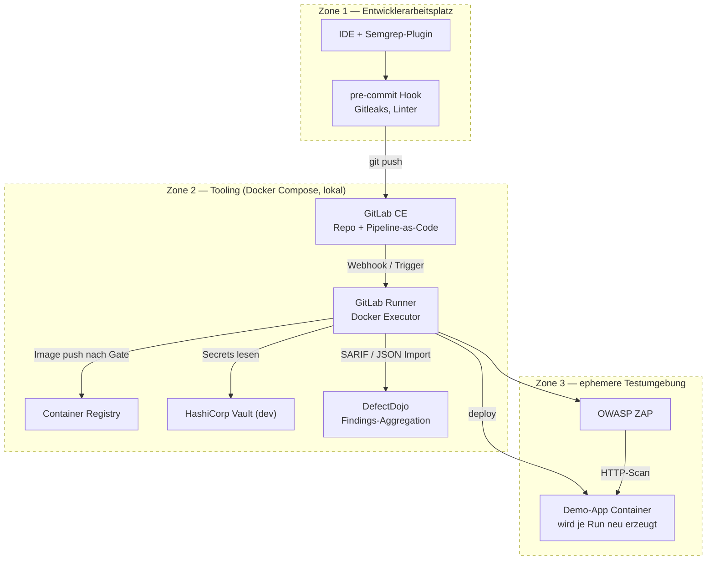
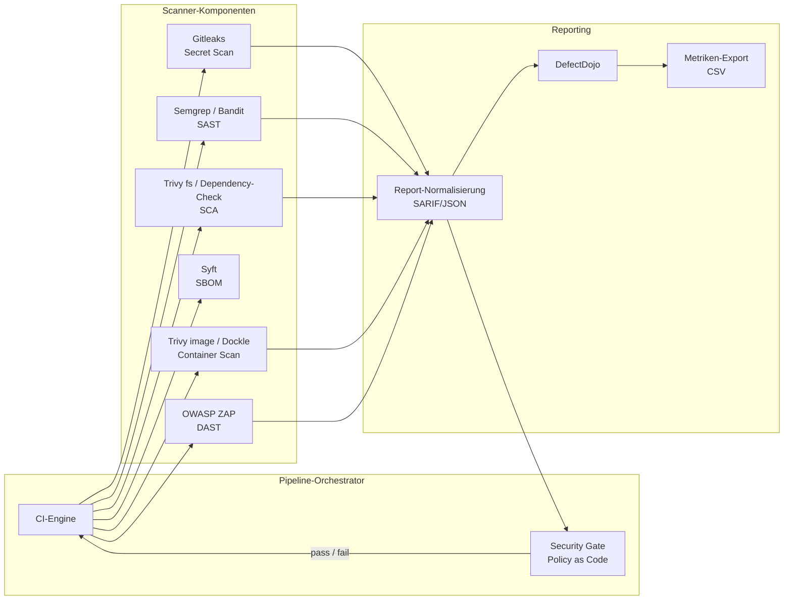
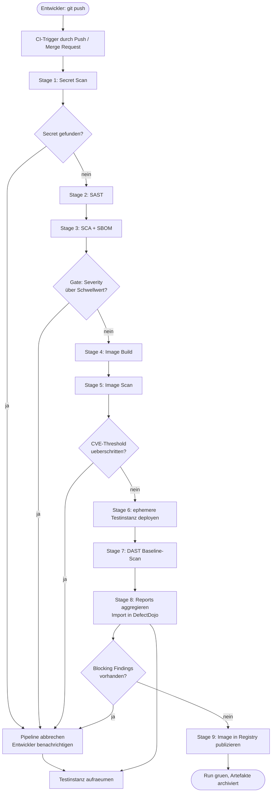
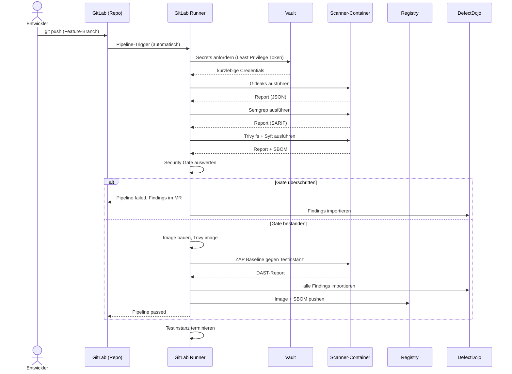
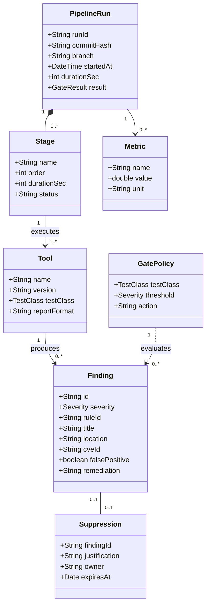
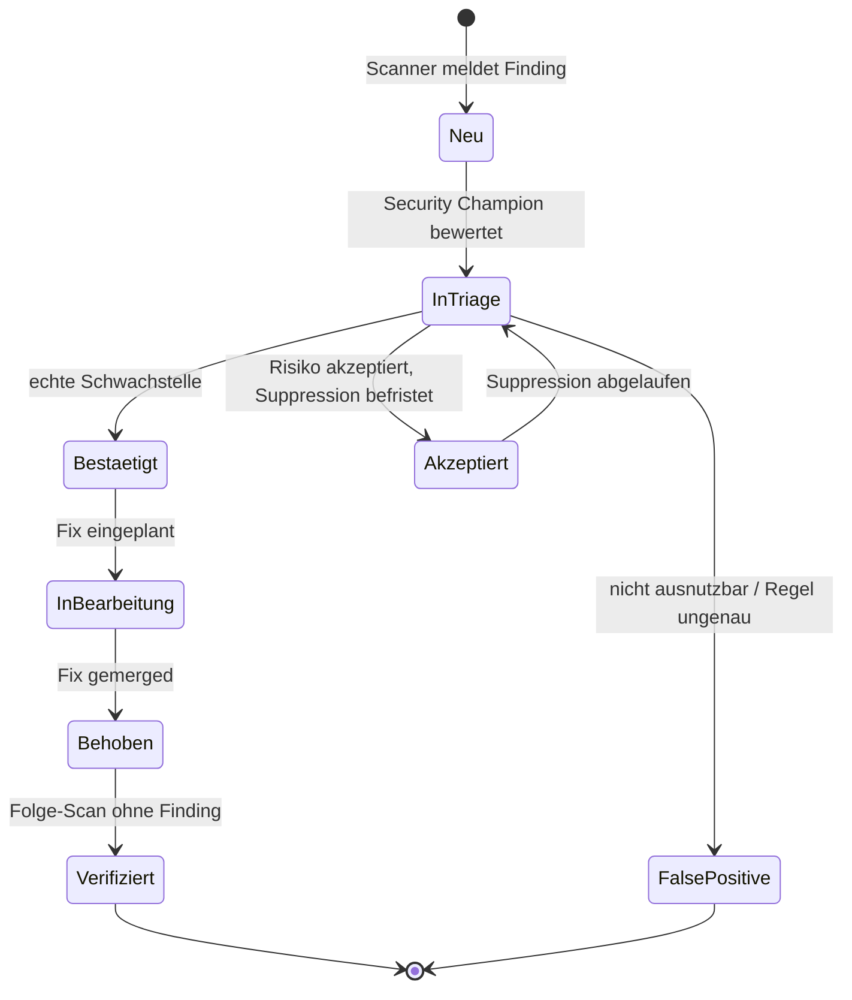

> Historischer Entwurf. Die aktuelle Implementierung und die unterstützten Einstiege sind in der [Pipeline-README](../../README.md) dokumentiert.

# Architekturplan — DevSecOps-Pipeline (Lehrprojekt Modul 6)

**Rolle:** Software-Architekt
**Basis:** `Anforderungsanalyse_DevSecOps_Pipeline.md`
**Status:** Architekturentwurf v1.0 — noch keine Implementierung

---

## 1. Architekturleitsätze

| Leitsatz | Konsequenz für den Entwurf |
|---|---|
| **Shift Left** — Sicherheit so früh wie möglich | Pre-Commit-Hooks und SAST vor dem Build |
| **Fail Fast, Fail Cheap** | Schnelle, billige Scans zuerst (Secrets, Lint), teure zuletzt (DAST) |
| **Policy as Code** | Schwellwerte und Gates liegen versioniert im Repo, nicht in UI-Klickkonfiguration |
| **Austauschbarkeit über Reportformate** | Alle Tools liefern SARIF/JSON → Aggregation ist tool-unabhängig (NF-05) |
| **Security by Default** | Gate blockiert im Standard; Ausnahmen nur als dokumentierte, befristete Suppression |
| **Alles lokal reproduzierbar** | Runner und Tools als Container, Start über eine Compose-Datei (NF-01, NF-04) |

---

## 2. Tool-Auswahl

### 2.1 In der Vorlesung genannte Werkzeuge (Folien 30–44)

| Kategorie | Vorlesung |
|---|---|
| Repository | GitLab, Gogs |
| CI/CD | GitLab Runner, Jenkins |
| Registry | Harbor, Artifactory |
| SAST / Code-Scanner | SonarQube |
| Secret Management | HashiCorp Vault |
| Container Runtime Security | NeuVector, Twistlock |
| Policy Enforcement | Open Policy Agent, Polaris |
| Monitoring / Logging | Prometheus, Grafana, Kibana, Logstash, Jaeger |
| Test | Selenium |
| Collaboration / Defect Mgmt. | Jira, Confluence, Mattermost |
| Orchestrierung | Kubernetes |
| Testklassen | SAST, DAST, SCA/FOSS-Scan, IAST, Pen-Test, Fuzzing |

### 2.2 Ausgewählter Stack für dieses Projekt

Auswahlkriterien: Open Source, lokal betreibbar, SARIF-/JSON-Output, schnelle Laufzeit, Abdeckung unterschiedlicher Testklassen (F-02).

| # | Testklasse | Tool | Begründung |
|---|---|---|---|
| 1 | Orchestrierung | **GitLab CE + GitLab Runner** (Alternative: Gitea + Jenkins) | Repo, CI und Container-Registry in einem Produkt; aus Vorlesung bekannt; Pipeline-as-Code in einer Datei |
| 2 | SAST | **Semgrep** (ergänzend **SonarQube CE**, **Bandit** für Python) | Regelbasiert, sekundenschnell, SARIF-Export, OWASP-Top-10-Regelsätze; SonarQube liefert zusätzlich die UI-Darstellung aus der Vorlesung |
| 3 | SCA / FOSS-Scan | **OWASP Dependency-Check** oder **Trivy (`fs`-Modus)**, ergänzend **Syft** für SBOM | Abhängigkeitsschwachstellen + Lizenzaspekte; SBOM-Erzeugung macht den Scan-Scope transparent |
| 4 | Secret Scanning | **Gitleaks** | Erkennt hartcodierte Schlüssel inkl. Git-History; sehr schnell, ideal als erster Gate-Schritt |
| 5 | Container-Image-Scan | **Trivy (`image`-Modus)**, Härtung mit **Dockle**/**hadolint** | Scan von Basis-Image und Paketen (Folie 31/33); Threshold-Prüfung direkt per Exit-Code |
| 6 | DAST | **OWASP ZAP** (Baseline-Scan im Container) | Dynamischer Scan gegen die eigene ephemere Testinstanz; aus Vorlesung als DAST-Klasse gefordert |
| 7 | Secret Management | **HashiCorp Vault (dev mode)** oder CI-Variablen | Secrets werden zur Laufzeit injiziert, nicht im Repo (F-05) |
| 8 | Findings-Aggregation | **OWASP DefectDojo** (Fallback: GitLab Security Dashboard) | Zentrales Defect Management, Deduplizierung, Severity-Statistik für die Metriken (F-04, F-09) |
| 9 | Policy / Gate | **Open Policy Agent (Conftest)** oder Shell-Gate auf SARIF-Severity | Schwellwert explizit als Regel, nicht implizit im Skript |

**Minimalkonfiguration zur Erfüllung von A-02 (4 Tools):** Gitleaks → Semgrep → Trivy → OWASP ZAP, orchestriert von GitLab CI.
**Ausbaustufe für die Bestnote:** zusätzlich Syft (SBOM), DefectDojo (Aggregation), Vault (Secrets).

> Bewusst **nicht** im Scope: NeuVector/Twistlock, CSPM/CNAPP, IAST, Managed Pen-Testing — zu großer Betriebsaufwand bzw. kommerziell (siehe Abgrenzung Abschnitt 8 der Anforderungsanalyse).

---

## 3. Systemarchitektur

### 3.1 Zonen- und Deployment-Sicht

Angelehnt an das Zonenkonzept und die Trust Boundaries der Vorlesung (Folien 13/14): Entwicklerarbeitsplatz, Tooling-Zone und ephemere Testzone sind getrennt; der DAST-Scan erreicht nur die Testzone.

### 3.2 Komponentendiagramm (UML-Komponentensicht)

---

## 4. Pipeline-Design

### 4.1 Stages

| Stage | Inhalt | Gate-Verhalten | Ziel-Laufzeit |
|---|---|---|---|
| 0 — `pre-commit` (lokal) | Gitleaks, Formatierung, Semgrep-Quickscan | blockiert den Commit | < 5 s |
| 1 — `secrets` | Gitleaks über Working Tree und History | **hard fail** bei jedem Treffer | < 20 s |
| 2 — `sast` | Semgrep (+ Bandit), SARIF-Export | fail bei HIGH/CRITICAL | < 60 s |
| 3 — `sca` | Trivy `fs` / Dependency-Check, Syft-SBOM | fail bei CRITICAL mit verfügbarem Fix | < 90 s |
| 4 — `build` | Container-Image bauen, hadolint auf Dockerfile | fail bei Build-Fehler | < 60 s |
| 5 — `image-scan` | Trivy `image`, Dockle | fail bei CRITICAL/HIGH (Threshold-Prüfung, Folie 32) | < 60 s |
| 6 — `deploy-test` | Ephemere Testinstanz starten | fail bei fehlendem Healthcheck | < 30 s |
| 7 — `dast` | ZAP Baseline-Scan gegen Testinstanz | **warn only** (hohe FP-Rate, Folie 39) | < 180 s |
| 8 — `report` | Reports aggregieren, DefectDojo-Import, Metriken | läuft immer (`always`) | < 30 s |
| 9 — `publish` | Image in Registry pushen, SBOM anhängen | nur bei grünem Gate | < 30 s |

### 4.2 Gate-Policy (Entwurf)

| Severity | Secrets | SAST | SCA | Image | DAST |
|---|---|---|---|---|---|
| CRITICAL | block | block | block | block | warn |
| HIGH | block | block | warn | block | warn |
| MEDIUM | block | warn | warn | warn | warn |
| LOW / INFO | block | info | info | info | info |

Ausnahmen ausschließlich als versionierte Suppression mit Begründung, Verantwortlichem und Ablaufdatum.

### 4.3 Aktivitätsdiagramm (UML-Aktivitätssicht)

### 4.4 Sequenzdiagramm (UML-Sequenzsicht, Trigger A-04)

---

## 5. Demo-Workloads (Erfüllung A-05 / F-08)

| # | Artefakt | Sprache | Eingebaute Schwachstelle | Erwartetes Finding durch |
|---|---|---|---|---|
| 1 | Minimale Web-API mit SQL-Zugriff | Python (Flask) | SQL-Injection durch String-Konkatenation, `debug=True` | Semgrep/Bandit (SAST), ZAP (DAST) |
| 2 | CLI-Tool mit veralteten Abhängigkeiten | Java oder Python | Bibliothek mit bekannter CVE (z. B. alte Log4j-/`requests`-Version) | Trivy fs / Dependency-Check (SCA) |
| 3 | Containerisierter Service | Dockerfile + Shell | Hartcodierter API-Key, veraltetes Basis-Image, `USER root` | Gitleaks, Trivy image, Dockle/hadolint |

Jedes Artefakt existiert in zwei Varianten: `vulnerable` (Gate bricht ab) und `fixed` (Gate grün). Damit wird die Wirksamkeit jedes Tools belegt statt nur seine Ausführung.

### 5.1 Datenmodell der Findings (UML-Klassensicht)

Die Normalisierung aller Toolausgaben auf ein gemeinsames Modell macht Aggregation und Metriken tool-unabhängig.

### 5.2 Zustandsdiagramm eines Findings (Defect Management, F-04)

---

## 6. Metriken und Dokumentation (A-07, F-09)

Je Pipeline-Run erfasst:
- Findings nach Severity und Testklasse
- Laufzeit je Stage (Nachweis des Fail-Fast-Prinzips)
- False-Positive-Quote je Tool — zentrale Erkenntnis für die Präsentation
- Gate-Entscheidung und auslösendes Finding
- Mean Time to Remediate zwischen `vulnerable`- und `fixed`-Run

**Struktur des Findings-Reports:** Run-ID · Commit · Tool · Regel/CVE · Severity · Codestelle · Bewertung · Maßnahme · Status

---

## 7. Umsetzungsplan

| Schritt | Inhalt | Verantwortlich | Aufwand |
|---|---|---|---|
| 1 | Repo anlegen, Tooling-Zone per Compose starten, Runner registrieren | Platform/Ops | 1 Tag |
| 2 | Drei Demo-Workloads in `vulnerable`/`fixed` erstellen | Developer | 1 Tag |
| 3 | Stages 1–3 (Secrets, SAST, SCA) inkl. SARIF-Artefakte | Security Champion | 1 Tag |
| 4 | Stages 4–5 (Build, Image-Scan) und Threshold-Logik | Platform/Ops | 0,5 Tag |
| 5 | Stages 6–7 (ephemere Testinstanz, ZAP) | Developer + Ops | 1 Tag |
| 6 | Stage 8–9 (Aggregation, Metriken, Publish) | Security Champion | 0,5 Tag |
| 7 | Findings-Triage, Report schreiben | alle | 1 Tag |
| 8 | Folien, Demo-Drehbuch, Probelauf, Screencast-Fallback | Doku/Präsentation | 0,5 Tag |

---

## 8. Demo-Drehbuch für die 15 Minuten (A-08)

| Zeit | Inhalt |
|---|---|
| 0–2 Min | Aufgabe, Zielbild, Architekturbild (Abschnitt 3.1) |
| 2–4 Min | Tool-Auswahl und Begründung je Testklasse |
| 4–10 Min | **Live-Demo:** Push des `vulnerable`-Snippets → Gate bricht ab → Finding im MR zeigen → Fix pushen → grüner Run → Image in Registry |
| 10–13 Min | Findings und Metriken: Severity-Verteilung, False-Positive-Quote je Tool |
| 13–15 Min | Lessons Learned, Grenzen (DAST-FP, Runtime-Security fehlt), Fragen |

Fallback bei Infrastrukturproblemen: vorbereiteter Screencast der beiden Runs.

---

## 9. Offene Architekturentscheidungen

| ID | Entscheidung | Optionen | Empfehlung |
|---|---|---|---|
| AD-1 | CI-Plattform | GitLab CE (All-in-One) vs. Gitea + Jenkins | GitLab CE — weniger Integrationsaufwand, näher an der Vorlesungsreferenz |
| AD-2 | SAST-Tool | Semgrep vs. SonarQube CE | Semgrep als Gate (schnell, SARIF), SonarQube optional für die Visualisierung |
| AD-3 | Aggregation | DefectDojo vs. GitLab Security Dashboard | DefectDojo, falls Ressourcen reichen — sonst GitLab-Dashboard |
| AD-4 | Secret Management | Vault dev-mode vs. CI-Variablen | Vault, da explizit Vorlesungsinhalt; CI-Variablen als Fallback |
| AD-5 | Gate-Implementierung | Shell-Skript auf SARIF vs. OPA/Conftest | OPA, wenn Zeit bleibt — macht Policy as Code sichtbar |
